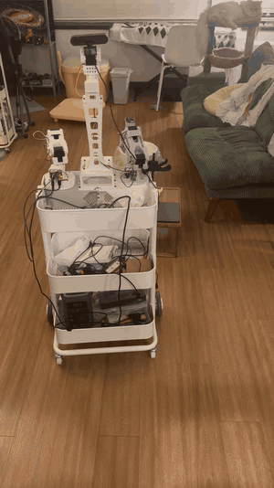
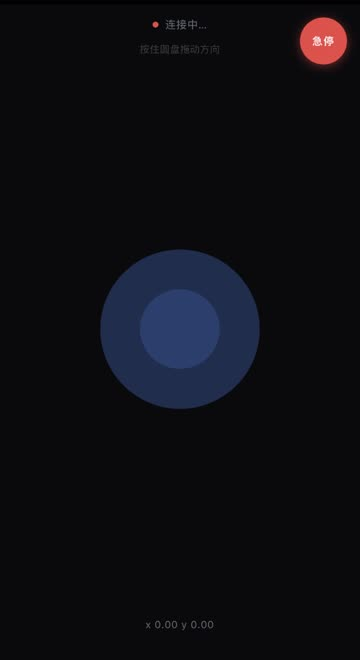

# XLeRobot 0.4 Differential-Drive Base: Teleop + Odometry

[中文说明见下方](#中文说明)

<p align="center">
  
  &nbsp;&nbsp;
  
</p>
<p align="center"><sub>Driving with the phone joystick (2× speed) · the joystick page / 手机摇杆遥控（2倍速）与遥控页面</sub></p>

A drop-in base driver for the **XLeRobot 0.4.0 two-wheel differential-drive base** (2 × Feetech STS3215 wheel motors). It gives you:

- **Phone joystick teleop** over WebSocket. Open a web page on your phone and drive; no app to install.
- **Wheel odometry** from the STS3215 encoders: x, y, heading, and measured speed.
- **A physical-unit velocity interface**: `set_velocity(v m/s, ω rad/s)`, shared by the joystick and any program you write.
- **UDP interfaces** for your own navigation code: send velocity commands in, receive odometry out, without touching the serial port.
- **Calibration scripts** that measure the real speed scale, wheel diameter and track width, then write them to the config.
- **A fake-motor mode** (`--port fake`) and tests, so you can try everything without hardware.

Terminal messages and the phone page are in Chinese; the code and comments are in English.

The official XLeRobot docs cover the 0.3 omni-wheel base; this project fills the gap for the 0.4 two-wheel version.

## Hardware

| Item | Default in `robot_config.json` |
| --- | --- |
| Wheel motors | 2 × STS3215, IDs **7 (left)** and **8 (right)**, 1 Mbps |
| Wheels | ~125 mm diameter (calibrate for the exact value) |
| Track width | ~508 mm (calibrate for the effective value) |
| Controller | Raspberry Pi 5 (Raspberry Pi OS) or any PC with Python 3.9+ |
| Motor bus | USB serial board (e.g. CH340 / `1a86`) |

The geometry and speed-scale values in the config were measured on the author's robot. They are a good starting point, but run the calibration on yours.

## Files

| File | Purpose |
| --- | --- |
| `joystick_server.py` | Main program: phone joystick server + UDP odometry/command ports |
| `joystick4.html` | Phone joystick page |
| `start.sh` | Starts the web page server (8000) and the joystick server (8765) together |
| `base_driver.py` | Differential-drive driver, fail-safe, odometry |
| `sts_bus.py` | STS3215 serial protocol (SYNC WRITE for speeds) |
| `joystick_mapping.py` | Joystick (x, y) → (v, ω), with deadzone and response curve |
| `control_arbiter.py` | Gives control to one phone page at a time |
| `odom_udp.py` | Publishes odometry over UDP |
| `calibrate_base.py` | Calibration: `check`, `straight`, `rotate` |
| `fake_sts.py` | Simulated STS3215 motors |
| `robot_config.json` | All parameters |
| `tests/` | Tests; no hardware or extra packages needed |

## Quick start

```bash
git clone https://github.com/Jinghao-X/xlerobot-diffdrive-teleop.git
cd xlerobot-diffdrive-teleop
python3 -m venv venv && source venv/bin/activate
pip install -r requirements.txt

python joystick_server.py --port fake   # try it with simulated motors
python tests/test_base.py && python tests/test_control.py && python tests/test_udp.py
```

## Running on a Raspberry Pi 5

1. **Serial permission:** `sudo usermod -aG dialout $USER`, then log out and back in.
2. **Stable port name:** run `ls /dev/serial/by-id/` and put the full path of the wheel board into `wheels.port`. Names like `/dev/ttyACM0` can swap after re-plugging.
3. **Start:** `./start.sh`. It prints a URL like `http://192.168.x.x:8000/joystick4.html`; open it on a phone on the same Wi-Fi.
4. Keep **only one** joystick page open while driving (see Troubleshooting).

## First drive and calibration

Use a flat floor, 1.5 m of free space ahead, and a ~0.8 m circle for rotating. Keep a hand near the robot; Ctrl+C stops at any time.

```bash
python calibrate_base.py check      # encoder direction, ~1 s (lift the wheels the first time)
python calibrate_base.py straight   # speed scale + real wheel diameter, ~10 s, needs a tape measure
python calibrate_base.py rotate     # effective track width, ~2 turns in place
```

Each step shows its result and asks before writing to the config.

## UDP interfaces (for your own navigation)

Both ports bind to **127.0.0.1 only**, so only programs on the robot itself can drive it. Messages are one JSON object per datagram.

**Odometry out, `127.0.0.1:5601`, ~30 Hz** (change with `--odom-udp HOST:PORT`, disable with `--odom-udp off`):

```json
{"type": "odom", "boot": "1730000000.123", "seq": 42, "t": 12345.678,
 "x": 0.52, "y": -0.03, "theta": 0.12, "v": 0.10, "w": 0.0,
 "left_m": 0.51, "right_m": 0.53, "healthy": true,
 "wheel_diameter_m": 0.1217, "track_width_m": 0.5129}
```

- `x, y` in metres, `theta` in radians (counter-clockwise positive), in the frame where the program started. x is forward.
- `t` is `time.monotonic()` of the encoder read (CLOCK_MONOTONIC, shared by all processes on Linux), so you can match it with camera timestamps.
- `boot` changes every time the program restarts and the odometry resets to (0, 0, 0). Re-anchor when it changes.
- `healthy: false` means encoder reads are failing.

**Velocity commands in, `127.0.0.1:5603`** (change with `--nav-port`, disable with `--nav-port 0`):

```json
{"type": "cmd", "v": 0.15, "w": 0.0}
```

- `v` in m/s (forward +), `w` in rad/s (counter-clockwise +). Send at 10 Hz or faster.
- **Fail-safe:** if no command arrives for `control.command_timeout_s` (0.5 s), the wheels stop.
- **The phone always wins:** while the joystick is pushed, UDP commands are ignored for 1 s after the last push. The page's idle heartbeats do not interrupt navigation.

Minimal client:

```python
import json, socket, time
cmd = socket.socket(socket.AF_INET, socket.SOCK_DGRAM)
odom = socket.socket(socket.AF_INET, socket.SOCK_DGRAM)
odom.bind(("127.0.0.1", 5601))
end = time.monotonic() + 2.0
while time.monotonic() < end:                       # drive forward slowly for 2 s
    cmd.sendto(json.dumps({"type": "cmd", "v": 0.1, "w": 0.0}).encode(), ("127.0.0.1", 5603))
    o = json.loads(odom.recv(4096))
    print(f"x={o['x']:.2f} y={o['y']:.2f} theta={o['theta']:.2f}")
    time.sleep(0.05)
```

## Configuration highlights

| Key | Meaning |
| --- | --- |
| `wheels.invert_left/right` | Flip a motor's direction if the robot drives backwards or spins |
| `wheels.max_units` | Speed limit in motor units (2000 ≈ 0.19 m/s with the default scale) |
| `wheels.min_motor_voltage` | Warn at startup if the motor supply is below this (V) |
| `control.command_timeout_s` | Fail-safe: stop if no command for this long |
| `control.smoothing` | Acceleration smoothing (0–1, lower = smoother) |
| `control.release_on_exit` | Turn torque off on exit so the robot can be pushed by hand |
| `joystick.deadzone`, `curve_exponent` | Joystick feel |

## Troubleshooting

These all happened on the real robot.

- **Motors don't move, or move weakly, and the startup voltage reads ~5 V.** The motor power supply isn't connected; the board is powered only from USB. Check the 12 V supply. The driver reads the motor voltage at startup and warns below `min_motor_voltage`.
- **Driving is jerky or stutters.** Usually two joystick pages are open, e.g. one on the phone and one in a laptop tab. A background page keeps sending "stop" heartbeats. The arbiter gives control to the active page, but close extra tabs anyway. The diagnostic line shows `忽略` (ignored) > 0 when this happens.
- **Motors don't respond after power-up.** Torque is off after a power cycle; the driver enables it at startup. If you use other tools on the same bus, make sure they don't turn it off.
- **Wheel mode doesn't persist after power cycling.** The mode lives in EEPROM, which must be unlocked before writing. The driver checks the mode and writes it, with unlock/lock, only if needed.
- **Odometry jumps or encoder reads fail.** Delayed USB-serial replies corrupted reads; speeds are now sent with a single SYNC WRITE. Don't run two programs on the same serial port at once.
- **Wheels stay locked after exit.** Fixed: torque is released on exit (`control.release_on_exit`).
- **Robot drifts sideways when driving straight.** Make sure both wheel motors are the same model (voltage version and gear ratio), then re-run `calibrate_base.py straight`.

## Contributing

Issues and pull requests are welcome. This project is independent of, and built for, [XLeRobot](https://github.com/Vector-Wangel/XLeRobot).

## License

[Apache License 2.0](LICENSE), the same as XLeRobot.

---

## 中文说明

这是 **XLeRobot 0.4.0 双轮差速底盘**的驱动程序，底盘用两个 Feetech STS3215 轮子电机。功能包括：

- **手机遥控**：手机打开一个网页就能开，不用装 App。
- **里程计**：从编码器算出机器人的位置 (x, y)、朝向和实际速度。
- **物理单位接口**：`set_velocity(线速度 m/s, 角速度 rad/s)`，手机摇杆和你自己的程序共用。
- **UDP 接口**：给你自己的导航程序用，速度指令进、里程计出，不用碰串口。
- **标定脚本**：实测速度换算、真实轮径和有效轮距，写入配置。
- **虚拟电机**（`--port fake`）和测试，不接硬件也能试。

官方文档目前只写到 0.3 全向轮底盘，本项目补上 0.4 双轮版本。

### 安装与试运行

```bash
python3 -m venv venv && source venv/bin/activate
pip install -r requirements.txt
python joystick_server.py --port fake      # 虚拟电机试运行
```

### 在树莓派 5 上运行

1. `sudo usermod -aG dialout $USER`，然后重新登录，才有串口权限。
2. 运行 `ls /dev/serial/by-id/`，把轮子控制板的完整路径填进 `wheels.port`。不要用 `/dev/ttyACM0`，插拔后可能互换。
3. 运行 `./start.sh`，用同一 Wi-Fi 下的手机打开它显示的网址。
4. 遥控时只开**一个**遥控页面。

### 标定

地面平整，前方留 1.5 米，旋转需要直径约 0.8 米的空间。手放在机器人旁边，Ctrl+C 随时停止。

```bash
python calibrate_base.py check       # 编码器方向，约 1 秒（第一次建议把轮子架空）
python calibrate_base.py straight    # 速度换算和真实轮径，约 10 秒，需要卷尺
python calibrate_base.py rotate      # 有效轮距，原地转约 2 圈
```

每一步都会显示结果，确认后才写入配置。

### UDP 接口

两个端口都只监听本机 `127.0.0.1`，同一 Wi-Fi 下的其他设备无法控制机器人。

- **里程计 5601 端口（发出，约 30 Hz）**：`x, y` 单位米，`theta` 单位弧度（逆时针为正），x 朝前；`t` 是编码器读取时的 `time.monotonic()`；`boot` 在每次重启后改变，此时里程计归零。
- **速度指令 5603 端口（接收）**：`{"type": "cmd", "v": 0.15, "w": 0.0}`，每秒至少发 10 次。超过 0.5 秒没收到新指令就自动停车。手机摇杆优先：推摇杆时，导航指令暂停 1 秒。

消息格式和示例代码见上面英文部分。

### 常见问题

- **电机不转或很无力，启动时电压显示约 5 V**：电机电源没接好，控制板只靠 USB 供电。请检查 12 V 电源。
- **开起来一顿一顿的**：多半同时开了两个遥控页面，后台页面一直在发“停止”心跳。程序会把控制权交给正在操作的页面，但最好关掉多余的页面。
- **上电后电机不响应**：断电后扭矩会关闭，程序启动时会自动打开。
- **断电后轮子模式丢失**：模式存在 EEPROM 里，写入前必须先解锁。程序会先检查，只在需要时写入。
- **里程计跳变或编码器读取失败**：不要让两个程序同时占用同一个串口。
- **退出后轮子锁死**：已修复，退出时会释放扭矩（`control.release_on_exit`）。
- **直走时跑偏**：确认两个电机型号相同（电压版本和减速比），然后重新运行 `calibrate_base.py straight`。

### 许可证

[Apache License 2.0](LICENSE)，与 XLeRobot 原项目一致。
